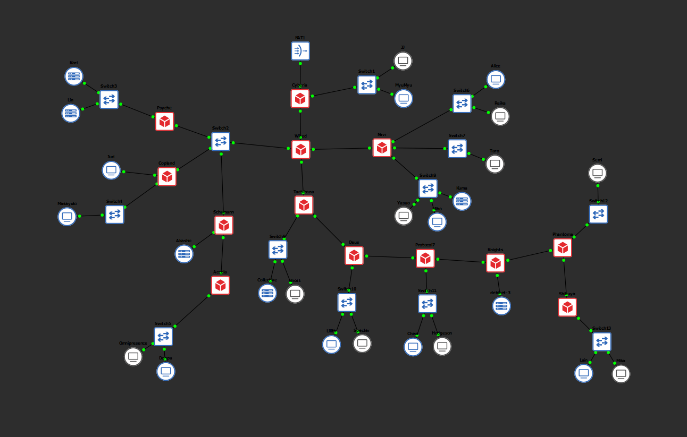
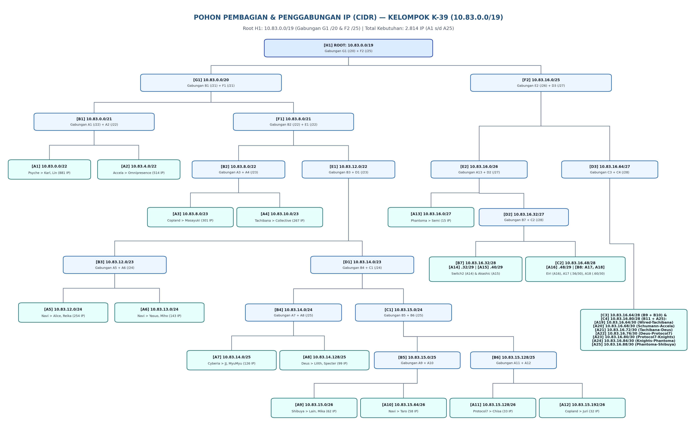

# Jarkom-Modul-4-2026-K-39 — Bagian CIDR (GNS3)

| Nama | NRP | Pengerjaan |
| :--- | :--- | :--- |
| Asfia Fahmisan | 5027251043 | VLSM (Cisco Packet Tracer) |
| Muhammad Atallah Mas'udi | 5027251071 | CIDR (GNS3) |

## Topologi Jaringan GNS3

Pada praktikum Modul 4 ini (*Serial Experiments Lain — Layer:04: The Wired Expansion*), skenario **CIDR (*Classless Inter-Domain Routing*)** dan **Supernetting** diimplementasikan pada simulator **GNS3** menggunakan *container* Docker **`ardhptr21/debinet:latest`**. Seluruh entitas dalam jaringan *The Wired* terhubung melalui router gerbang utama **Cyberia** yang tersambung ke dunia luar melalui node **NAT1** (`eth0`), mengalir ke router pusat **Wired**, lalu bercabang menuju router **Navi** di timur, rantai **Tachibana** s.d. **Shibuya** di selatan, serta segmen bersama (*shared broadcast domain*) **Switch2** milik **Psyche**, **Copland**, dan **Schumann** di barat:



### Parameter Global GNS3 & CIDR:
- **Prefix IP Kelompok K-39**: `10.83.0.0/16` (Supernet Induk Hasil Penggabungan `H1`: `10.83.0.0/19`)
- **Metode Perhitungan GNS3**: CIDR (*Classless Inter-Domain Routing* — *Bottom-Up Supernetting / Route Aggregation*)
- **Image Container GNS3**: `ardhptr21/debinet:latest` (Debian Linux dengan `iproute2` & `iptables`)
- **Upstream Internet (NAT)**: Interface `eth0` pada router `Cyberia` terhubung ke `NAT1` (`192.168.122.0/24`) dengan translasi `iptables -t nat -A POSTROUTING -o eth0 -j MASQUERADE`.
- **Jumlah Subnet**: 25 Subnet (`A1` s.d. `A25`) yang digabungkan secara bertahap melalui 7 tahap penggabungan (`B1`–`B11`, `C1`–`C4`, `D1`–`D3`, `E1`–`E2`, `F1`–`F2`, `G1`, hingga `H1`).
- **Total Kebutuhan IP**: 2.814 IP (tanpa celah / *zero gap* dalam rentang `10.83.0.0` s.d. `10.83.16.91`).
- **Total Perangkat**: 13 Router Docker (`debinet`), 13 Ethernet Switch GNS3 (`Switch1`–`Switch13`), 25 Node Host Docker (`debinet`), dan 1 Node `NAT1`.

### Struktur Direktori Folder `CIDR/`:
```text
├── CIDR/                                    # Folder Induk Pengerjaan CIDR & GNS3 (Muhammad Atallah Mas'udi)
│   ├── script_bash/                         # Skrip otomatisasi konfigurasi Linux (/root/script.sh) di GNS3
│   │   ├── hosts/                           # Skrip penetapan IP & default gateway 25 host (.sh)
│   │   ├── routers/                         # Skrip ip_forward, iptables NAT, & static routing 13 router (.sh)
│   │   ├── hitung_cidr.sh                   # Skrip ringkasan tahapan penggabungan & supernetting CIDR
│   │   └── test_ping_semua.sh               # Skrip matriks pengujian konektivitas antar-node di GNS3
│   ├── Modul4_CIDR_10.83.gns3project        # File GNS3 Portable Project siap uji (CIDR 10.83)
│   ├── Jarkom-Modul-4-2026-K-39.xlsx        # Lembar kerja resmi perhitungan VLSM & CIDR Kelompok K-39
│   ├── tree_pembagian_ip_cidr_10.83.png     # Diagram visual pohon penggabungan & alokasi IP CIDR
│   └── README.md                            # Laporan resmi pengerjaan CIDR di GNS3
```

### Tabel Alokasi IP Address Host (25 Node Docker `debinet`):
| Node | Interface | IP Address | Netmask | Prefix | Gateway | Router Induk | Subnet |
| :--- | :--- | :--- | :--- | :---: | :--- | :--- | :--- |
| **Karl (700 host)** | `eth0` | `10.83.0.2` | `255.255.252.0` | `/22` | `10.83.0.1` | Psyche | Subnet A1 |
| **Lin (180 host)** | `eth0` | `10.83.0.3` | `255.255.252.0` | `/22` | `10.83.0.1` | Psyche | Subnet A1 |
| **Omnipresence (510 host)** | `eth0` | `10.83.4.2` | `255.255.252.0` | `/22` | `10.83.4.1` | Accela | Subnet A2 |
| **Denpa (3 host)** | `eth0` | `10.83.4.3` | `255.255.252.0` | `/22` | `10.83.4.1` | Accela | Subnet A2 |
| **Masayuki (300 host)** | `eth0` | `10.83.8.2` | `255.255.254.0` | `/23` | `10.83.8.1` | Copland | Subnet A3 |
| **Collective (260 host)** | `eth0` | `10.83.10.2` | `255.255.254.0` | `/23` | `10.83.10.1` | Tachibana | Subnet A4 |
| **Ghost (6 host)** | `eth0` | `10.83.10.3` | `255.255.254.0` | `/23` | `10.83.10.1` | Tachibana | Subnet A4 |
| **Alice (208 host)** | `eth0` | `10.83.12.2` | `255.255.255.0` | `/24` | `10.83.12.1` | Navi | Subnet A5 |
| **Reika (45 host)** | `eth0` | `10.83.12.3` | `255.255.255.0` | `/24` | `10.83.12.1` | Navi | Subnet A5 |
| **Yasuo (120 host)** | `eth0` | `10.83.13.2` | `255.255.255.0` | `/24` | `10.83.13.1` | Navi | Subnet A6 |
| **Miho (18 host)** | `eth0` | `10.83.13.3` | `255.255.255.0` | `/24` | `10.83.13.1` | Navi | Subnet A6 |
| **Kuma (4 host)** | `eth0` | `10.83.13.4` | `255.255.255.0` | `/24` | `10.83.13.1` | Navi | Subnet A6 |
| **JJ (95 host)** | `eth0` | `10.83.14.2` | `255.255.255.128` | `/25` | `10.83.14.1` | Cyberia | Subnet A7 |
| **MyuMyu (30 host)** | `eth0` | `10.83.14.3` | `255.255.255.128` | `/25` | `10.83.14.1` | Cyberia | Subnet A7 |
| **Lilith (77 host)** | `eth0` | `10.83.14.130` | `255.255.255.128` | `/25` | `10.83.14.129` | Deus | Subnet A8 |
| **Specter (21 host)** | `eth0` | `10.83.14.131` | `255.255.255.128` | `/25` | `10.83.14.129` | Deus | Subnet A8 |
| **Lain (57 host)** | `eth0` | `10.83.15.2` | `255.255.255.192` | `/26` | `10.83.15.1` | Shibuya | Subnet A9 |
| **Mika (4 host)** | `eth0` | `10.83.15.3` | `255.255.255.192` | `/26` | `10.83.15.1` | Shibuya | Subnet A9 |
| **Taro (57 host)** | `eth0` | `10.83.15.66` | `255.255.255.192` | `/26` | `10.83.15.65` | Navi | Subnet A10 |
| **Chisa (23 host)** | `eth0` | `10.83.15.130` | `255.255.255.192` | `/26` | `10.83.15.129` | Protocol7 | Subnet A11 |
| **Hodgeson (9 host)** | `eth0` | `10.83.15.131` | `255.255.255.192` | `/26` | `10.83.15.129` | Protocol7 | Subnet A11 |
| **Juri (31 host)** | `eth0` | `10.83.15.194` | `255.255.255.192` | `/26` | `10.83.15.193` | Copland | Subnet A12 |
| **Semi (14 host)** | `eth0` | `10.83.16.2` | `255.255.255.224` | `/27` | `10.83.16.1` | Phantoma | Subnet A13 |
| **Akashic (3 host)** | `eth0` | `10.83.16.42` | `255.255.255.248` | `/29` | `10.83.16.41` | Schumann | Subnet A15 |
| **Eiri (2 host)** | `eth0` | `10.83.16.50` | `255.255.255.248` | `/29` | `10.83.16.49` | Knights | Subnet A16 |

### Tabel Alokasi IP Address Interface Router (13 Router Docker `debinet`):
| Router | Interface GNS3 | IP Address | Subnet Mask | Prefix | Keterangan Sambungan |
| :--- | :--- | :--- | :--- | :---: | :--- |
| **Cyberia** | `eth0`<br>`eth1`<br>`eth2` | `DHCP / 192.168.122.2`<br>`10.83.14.1`<br>`10.83.16.57` | `255.255.255.0`<br>`255.255.255.128`<br>`255.255.255.252` | `/24`<br>`/25`<br>`/30` | Uplink ke NAT1 (Masquerade)<br>LAN Switch1: JJ & MyuMyu (A7)<br>Point-to-point ke Wired (A17) |
| **Wired** | `eth0`<br>`eth1`<br>`eth2`<br>`eth3` | `10.83.16.58`<br>`10.83.16.33`<br>`10.83.16.61`<br>`10.83.16.65` | `255.255.255.252`<br>`255.255.255.248`<br>`255.255.255.252`<br>`255.255.255.252` | `/30`<br>`/29`<br>`/30`<br>`/30` | Point-to-point ke Cyberia (A17)<br>Shared Switch2 ke Psyche, Copland, Schumann (A14)<br>Point-to-point ke Navi (A18)<br>Point-to-point ke Tachibana (A19) |
| **Navi** | `eth0`<br>`eth1`<br>`eth2`<br>`eth3` | `10.83.16.62`<br>`10.83.12.1`<br>`10.83.15.65`<br>`10.83.13.1` | `255.255.255.252`<br>`255.255.255.0`<br>`255.255.255.192`<br>`255.255.255.0` | `/30`<br>`/24`<br>`/26`<br>`/24` | Point-to-point ke Wired (A18)<br>LAN Switch6: Alice & Reika (A5)<br>LAN Switch7: Taro (A10)<br>LAN Switch8: Yasuo, Miho, Kuma (A6) |
| **Psyche** | `eth0`<br>`eth1` | `10.83.16.34`<br>`10.83.0.1` | `255.255.255.248`<br>`255.255.252.0` | `/29`<br>`/22` | Shared Switch2 dari Wired (A14)<br>LAN Switch3: Karl & Lin (A1) |
| **Copland** | `eth0`<br>`eth1`<br>`eth2` | `10.83.16.35`<br>`10.83.15.193`<br>`10.83.8.1` | `255.255.255.248`<br>`255.255.255.192`<br>`255.255.254.0` | `/29`<br>`/26`<br>`/23` | Shared Switch2 dari Wired (A14)<br>Direct Link ke Juri (A12)<br>LAN Switch4: Masayuki (A3) |
| **Schumann** | `eth0`<br>`eth1`<br>`eth2` | `10.83.16.36`<br>`10.83.16.41`<br>`10.83.16.69` | `255.255.255.248`<br>`255.255.255.248`<br>`255.255.255.252` | `/29`<br>`/29`<br>`/30` | Shared Switch2 dari Wired (A14)<br>Direct Link ke Akashic (A15)<br>Point-to-point ke Accela (A20) |
| **Accela** | `eth0`<br>`eth1` | `10.83.16.70`<br>`10.83.4.1` | `255.255.255.252`<br>`255.255.252.0` | `/30`<br>`/22` | Point-to-point ke Schumann (A20)<br>LAN Switch5: Omnipresence & Denpa (A2) |
| **Tachibana** | `eth0`<br>`eth1`<br>`eth2` | `10.83.16.66`<br>`10.83.10.1`<br>`10.83.16.73` | `255.255.255.252`<br>`255.255.254.0`<br>`255.255.255.252` | `/30`<br>`/23`<br>`/30` | Point-to-point ke Wired (A19)<br>LAN Switch9: Collective & Ghost (A4)<br>Point-to-point ke Deus (A21) |
| **Deus** | `eth0`<br>`eth1`<br>`eth2` | `10.83.16.74`<br>`10.83.14.129`<br>`10.83.16.77` | `255.255.255.252`<br>`255.255.255.128`<br>`255.255.255.252` | `/30`<br>`/25`<br>`/30` | Point-to-point ke Tachibana (A21)<br>LAN Switch10: Lilith & Specter (A8)<br>Point-to-point ke Protocol7 (A22) |
| **Protocol7** | `eth0`<br>`eth1`<br>`eth2` | `10.83.16.78`<br>`10.83.15.129`<br>`10.83.16.81` | `255.255.255.252`<br>`255.255.255.192`<br>`255.255.255.252` | `/30`<br>`/26`<br>`/30` | Point-to-point ke Deus (A22)<br>LAN Switch11: Chisa & Hodgeson (A11)<br>Point-to-point ke Knights (A23) |
| **Knights** | `eth0`<br>`eth1`<br>`eth2` | `10.83.16.82`<br>`10.83.16.49`<br>`10.83.16.85` | `255.255.255.252`<br>`255.255.255.248`<br>`255.255.255.252` | `/30`<br>`/29`<br>`/30` | Point-to-point ke Protocol7 (A23)<br>Direct Link ke Eiri (A16)<br>Point-to-point ke Phantoma (A24) |
| **Phantoma** | `eth0`<br>`eth1`<br>`eth2` | `10.83.16.86`<br>`10.83.16.1`<br>`10.83.16.89` | `255.255.255.252`<br>`255.255.255.224`<br>`255.255.255.252` | `/30`<br>`/27`<br>`/30` | Point-to-point ke Knights (A24)<br>LAN Switch12: Semi (A13)<br>Point-to-point ke Shibuya (A25) |
| **Shibuya** | `eth0`<br>`eth1` | `10.83.16.90`<br>`10.83.15.1` | `255.255.255.252`<br>`255.255.255.192` | `/30`<br>`/26` | Point-to-point ke Phantoma (A25)<br>LAN Switch13: Lain & Mika (A9) |

## 1. Analisis Kebutuhan Host & Penentuan Netmask Dasar (A1 - A25)

Langkah pertama dalam metode **CIDR (*Classless Inter-Domain Routing*)** adalah menentukan kebutuhan alamat IP pada setiap segmen rute dengan menjumlahkan seluruh host dan antarmuka router yang berada pada segmen tersebut. Ukuran blok biner tiap segmen ditentukan agar memenuhi $2^{(32 - 	ext{Prefix})} \ge 	ext{Jumlah IP} + 2$ (untuk mengakomodasi *Network Address* dan *Broadcast Address*).

| Nama Subnet | Rute | Rincian Kebutuhan (Host + Router) | Jumlah IP | Netmask | Kapasitas Blok |
| :---: | :--- | :--- | :---: | :---: | :---: |
| **A1** | `Psyche > Switch3 > Karl, Lin` | $700 + 180 + 1	ext{ router}$ | 881 | `/22` | 1.024 |
| **A2** | `Accela > Switch5 > Omnipresence, Denpa` | $510 + 3 + 1	ext{ router}$ | 514 | `/22` | 1.024 |
| **A3** | `Copland > Switch4 > Masayuki` | $300 + 1	ext{ router}$ | 301 | `/23` | 512 |
| **A4** | `Tachibana > Switch9 > Collective, Ghost` | $260 + 6 + 1	ext{ router}$ | 267 | `/23` | 512 |
| **A5** | `Navi > Switch6 > Alice, Reika` | $208 + 45 + 1	ext{ router}$ | 254 | `/24` | 256 |
| **A6** | `Navi > Switch8 > Yasuo, Miho, Kuma` | $120 + 18 + 4 + 1	ext{ router}$ | 143 | `/24` | 256 |
| **A7** | `Cyberia > Switch1 > JJ, MyuMyu` | $95 + 30 + 1	ext{ router}$ | 126 | `/25` | 128 |
| **A8** | `Deus > Switch10 > Lilith, Specter` | $77 + 21 + 1	ext{ router}$ | 99 | `/25` | 128 |
| **A9** | `Shibuya > Switch13 > Lain, Mika` | $57 + 4 + 1	ext{ router}$ | 62 | `/26` | 64 |
| **A10** | `Navi > Switch7 > Taro` | $57 + 1	ext{ router}$ | 58 | `/26` | 64 |
| **A11** | `Protocol7 > Switch11 > Chisa, Hodgeson` | $23 + 9 + 1	ext{ router}$ | 33 | `/26` | 64 |
| **A12** | `Copland > Juri` | $31 + 1	ext{ router}$ | 32 | `/26` | 64 |
| **A13** | `Phantoma > Switch12 > Semi` | $14 + 1	ext{ router}$ | 15 | `/27` | 32 |
| **A14** | `Wired > Switch2 > Psyche, Copland, Schumann` | $4	ext{ router interface}$ | 4 | `/29` | 8 |
| **A15** | `Schumann > Akashic` | $3 + 1	ext{ router}$ | 4 | `/29` | 8 |
| **A16** | `Knights > Eiri` | $2 + 1	ext{ router}$ | 3 | `/29` | 8 |
| **A17 - A25** | `Point-to-Point Antar Router (9 Segmen)` | $2	ext{ router interface per link}$ | $9 	imes 2 = 18$ | `/30` | $9 	imes 4 = 36$ |
| **Total** | **Seluruh Segmen The Wired** | **25 Subnet** | **2.814** | **`/20` (Blok Pohon `/19`)** | **4.188** |

## 2. Tabel Penggabungan Subnetting CIDR (Bottom-Up Supernetting Tahap I – VII)

Berbeda dengan VLSM yang memecah blok secara *top-down*, metode **CIDR (*Bottom-Up Supernetting*)** menggabungkan pasangan subnet dari tingkat daun (`A1` s.d. `A25`) ke atas secara bertahap menggunakan aturan agregasi biner:

$$\text{Netmask Akhir} = /\left(\min(\text{Prefix}_1, \text{Prefix}_2) - 1\right)$$

Agar tidak terjadi pemborosan ruang alamat (*zero address gap*), penggabungan dilakukan antara pasangan subnet yang memiliki ukuran prefix setara atau paling berdekatan pada setiap tahap sebagaimana tercatat pada Sheet **`Penggabungan - CIDR`** di file [Jarkom-Modul-4-2026-K-39.xlsx](Jarkom-Modul-4-2026-K-39.xlsx):

### Tahap I (Menghasilkan `B1` s.d. `B11`):
| Subnet Hasil | Gabungan 1 (Subnet) | Gabungan 1 (Netmask) | Gabungan 2 (Subnet) | Gabungan 2 (Netmask) | Netmask Akhir |
| :---: | :---: | :---: | :---: | :---: | :---: |
| **B1** | `A1` | `/22` | `A2` | `/22` | **`/21`** |
| **B2** | `A3` | `/23` | `A4` | `/23` | **`/22`** |
| **B3** | `A5` | `/24` | `A6` | `/24` | **`/23`** |
| **B4** | `A7` | `/25` | `A8` | `/25` | **`/24`** |
| **B5** | `A9` | `/26` | `A10` | `/26` | **`/25`** |
| **B6** | `A11` | `/26` | `A12` | `/26` | **`/25`** |
| **B7** | `A14` | `/29` | `A15` | `/29` | **`/28`** |
| **B8** | `A17` | `/30` | `A18` | `/30` | **`/29`** |
| **B9** | `A19` | `/30` | `A20` | `/30` | **`/29`** |
| **B10** | `A21` | `/30` | `A22` | `/30` | **`/29`** |
| **B11** | `A23` | `/30` | `A24` | `/30` | **`/29`** |

### Tahap II s.d. Tahap VII (Menghasilkan `C1` s.d. Root `H1`):
| Tahap | Subnet Hasil | Gabungan 1 (Subnet) | Gabungan 1 (Netmask) | Gabungan 2 (Subnet) | Gabungan 2 (Netmask) | Netmask Akhir |
| :---: | :---: | :---: | :---: | :---: | :---: | :---: |
| **II** | **C1** | `B5` | `/25` | `B6` | `/25` | **`/24`** |
| **II** | **C2** | `A16` | `/29` | `B8` | `/29` | **`/28`** |
| **II** | **C3** | `B9` | `/29` | `B10` | `/29` | **`/28`** |
| **II** | **C4** | `B11` | `/29` | `A25` | `/30` | **`/28`** |
| **III** | **D1** | `B4` | `/24` | `C1` | `/24` | **`/23`** |
| **III** | **D2** | `B7` | `/28` | `C2` | `/28` | **`/27`** |
| **III** | **D3** | `C3` | `/28` | `C4` | `/28` | **`/27`** |
| **IV** | **E1** | `B3` | `/23` | `D1` | `/23` | **`/22`** |
| **IV** | **E2** | `A13` | `/27` | `D2` | `/27` | **`/26`** |
| **V** | **F1** | `B2` | `/22` | `E1` | `/22` | **`/21`** |
| **V** | **F2** | `E2` | `/26` | `D3` | `/27` | **`/25`** |
| **VI** | **G1** | `B1` | `/21` | `F1` | `/21` | **`/20`** |
| **VII** | **H1 (Root)** | `G1` | `/20` | `F2` | `/25` | **`/19`** |

## 3. Desain Pohon Penggabungan & Pembagian IP CIDR (CIDR Tree)

Dari hasil penggabungan puncak **`H1` (`10.83.0.0/19`)**, blok alamat diturunkan kembali ke setiap cabang anak kiri (`Gabungan 1`) dan anak kanan (`Gabungan 2`). Karena seluruh blok mulai dari `B1 (/21)` hingga `C1 (/24)` di bawah `G1 (/20)` berukuran penuh ($4.096	ext{ IP}$), maka `F2 (/25)` langsung menempati batas awal blok `/20` kedua yaitu `10.83.16.0/25` tanpa ada satu pun alamat IP yang terbuang di antaranya:



## 4. Rencana Pengalamatan & Tabel Subnetting CIDR (A1 - A25)

Tabel berikut merupakan hasil penelusuran alamat IP dari pohon CIDR pada Sheet **`Pembagian IP - CIDR`** di file [Jarkom-Modul-4-2026-K-39.xlsx](Jarkom-Modul-4-2026-K-39.xlsx):

| Subnet | Network ID | Netmask | Broadcast | Range IP |
| :---: | :--- | :--- | :--- | :--- |
| **A1** | `10.83.0.0` | `255.255.252.0` | `10.83.3.255` | `10.83.0.1 - 10.83.3.254` |
| **A2** | `10.83.4.0` | `255.255.252.0` | `10.83.7.255` | `10.83.4.1 - 10.83.7.254` |
| **A3** | `10.83.8.0` | `255.255.254.0` | `10.83.9.255` | `10.83.8.1 - 10.83.9.254` |
| **A4** | `10.83.10.0` | `255.255.254.0` | `10.83.11.255` | `10.83.10.1 - 10.83.11.254` |
| **A5** | `10.83.12.0` | `255.255.255.0` | `10.83.12.255` | `10.83.12.1 - 10.83.12.254` |
| **A6** | `10.83.13.0` | `255.255.255.0` | `10.83.13.255` | `10.83.13.1 - 10.83.13.254` |
| **A7** | `10.83.14.0` | `255.255.255.128` | `10.83.14.127` | `10.83.14.1 - 10.83.14.126` |
| **A8** | `10.83.14.128` | `255.255.255.128` | `10.83.14.255` | `10.83.14.129 - 10.83.14.254` |
| **A9** | `10.83.15.0` | `255.255.255.192` | `10.83.15.63` | `10.83.15.1 - 10.83.15.62` |
| **A10** | `10.83.15.64` | `255.255.255.192` | `10.83.15.127` | `10.83.15.65 - 10.83.15.126` |
| **A11** | `10.83.15.128` | `255.255.255.192` | `10.83.15.191` | `10.83.15.129 - 10.83.15.190` |
| **A12** | `10.83.15.192` | `255.255.255.192` | `10.83.15.255` | `10.83.15.193 - 10.83.15.254` |
| **A13** | `10.83.16.0` | `255.255.255.224` | `10.83.16.31` | `10.83.16.1 - 10.83.16.30` |
| **A14** | `10.83.16.32` | `255.255.255.248` | `10.83.16.39` | `10.83.16.33 - 10.83.16.38` |
| **A15** | `10.83.16.40` | `255.255.255.248` | `10.83.16.47` | `10.83.16.41 - 10.83.16.46` |
| **A16** | `10.83.16.48` | `255.255.255.248` | `10.83.16.55` | `10.83.16.49 - 10.83.16.54` |
| **A17** | `10.83.16.56` | `255.255.255.252` | `10.83.16.59` | `10.83.16.57 - 10.83.16.58` |
| **A18** | `10.83.16.60` | `255.255.255.252` | `10.83.16.63` | `10.83.16.61 - 10.83.16.62` |
| **A19** | `10.83.16.64` | `255.255.255.252` | `10.83.16.67` | `10.83.16.65 - 10.83.16.66` |
| **A20** | `10.83.16.68` | `255.255.255.252` | `10.83.16.71` | `10.83.16.69 - 10.83.16.70` |
| **A21** | `10.83.16.72` | `255.255.255.252` | `10.83.16.75` | `10.83.16.73 - 10.83.16.74` |
| **A22** | `10.83.16.76` | `255.255.255.252` | `10.83.16.79` | `10.83.16.77 - 10.83.16.78` |
| **A23** | `10.83.16.80` | `255.255.255.252` | `10.83.16.83` | `10.83.16.81 - 10.83.16.82` |
| **A24** | `10.83.16.84` | `255.255.255.252` | `10.83.16.87` | `10.83.16.85 - 10.83.16.86` |
| **A25** | `10.83.16.88` | `255.255.255.252` | `10.83.16.91` | `10.83.16.89 - 10.83.16.90` |

## 5. Konfigurasi Router Gateway Cyberia (NAT) & Core Hub Wired di GNS3

Sesuai aturan praktikum nomor 5, seluruh konfigurasi diletakkan pada `/root/script.sh` di masing-masing container `ardhptr21/debinet:latest`. Karena container Docker tidak menjalankan daemon `/etc/init.d/networking`, penetapan alamat IP dilakukan secara langsung menggunakan utilitas kernel `iproute2` (`ip addr`, `ip link`, `ip route`) sekaligus disimpan ke `/etc/network/interfaces`.

### Konfigurasi dan Penjelasan Supernetting CIDR:
- **Cyberia (`script_bash/routers/cyberia.sh`)**:
  - Meminta IP uplink ke `NAT1` pada `eth0` melalui `/gns3/bin/udhcpc` serta mengaktifkan translasi alamat `iptables -t nat -A POSTROUTING -o eth0 -j MASQUERADE` agar seluruh node di dalam *The Wired* dapat mengakses jaringan luar.
  - Menggunakan **1 baris *supernet route* CIDR** (`ip route replace 10.83.0.0/19 via 10.83.16.58`) yang mewakili hasil penggabungan puncak **`H1 (/19)`**. Karena kernel Linux menerapkan *Longest Prefix Match*, paket menuju `A7` (`10.83.14.0/25` di `eth1`) dan `A17` (`10.83.16.56/30` di `eth2`) tetap dikirim langsung ke antarmuka lokal, sedangkan seluruh paket menuju 23 subnet lainnya di bawah `Wired` otomatis dirutekan hanya dengan satu baris rute tersebut.
- **Wired (`script_bash/routers/wired.sh`)**:
  - Merangkum rute ke cabang **Navi** (`A5` + `A6`) menggunakan *supernet* **`B3` (`10.83.12.0/23`)** serta merangkum link rantai bawah menggunakan *supernet* **`B10` (`10.83.16.72/29`)** dan **`C4` (`10.83.16.80/28`)**.

#### Skrip Bash Router Cyberia (`script_bash/routers/cyberia.sh`):
```bash
#!/bin/bash
ip link set eth0 up
/gns3/bin/udhcpc -i eth0 -s /gns3/etc/udhcpc.script 2>/dev/null || (ip addr add 192.168.122.2/24 dev eth0 && ip route replace default via 192.168.122.1)

ip addr flush dev eth1
ip addr add 10.83.14.1/25 dev eth1
ip link set eth1 up

ip addr flush dev eth2
ip addr add 10.83.16.57/30 dev eth2
ip link set eth2 up

sysctl -w net.ipv4.ip_forward=1
iptables -t nat -F
iptables -t nat -A POSTROUTING -o eth0 -j MASQUERADE

# Supernetting CIDR H1: 1 baris mencakup seluruh 23 subnet di bawah Wired
ip route replace 10.83.0.0/19 via 10.83.16.58
```

#### Skrip Bash Router Wired (`script_bash/routers/wired.sh`):
```bash
#!/bin/bash
sysctl -w net.ipv4.ip_forward=1

ip addr flush dev eth0 && ip addr add 10.83.16.58/30 dev eth0 && ip link set eth0 up
ip addr flush dev eth1 && ip addr add 10.83.16.33/29 dev eth1 && ip link set eth1 up
ip addr flush dev eth2 && ip addr add 10.83.16.61/30 dev eth2 && ip link set eth2 up
ip addr flush dev eth3 && ip addr add 10.83.16.65/30 dev eth3 && ip link set eth3 up

ip route replace default via 10.83.16.57
ip route replace 10.83.14.0/25 via 10.83.16.57

# Rute Cabang Barat (Switch2: Psyche, Copland, Schumann, Accela)
ip route replace 10.83.0.0/22 via 10.83.16.34
ip route replace 10.83.8.0/23 via 10.83.16.35
ip route replace 10.83.15.192/26 via 10.83.16.35
ip route replace 10.83.4.0/22 via 10.83.16.36
ip route replace 10.83.16.40/29 via 10.83.16.36
ip route replace 10.83.16.68/30 via 10.83.16.36

# Rute Cabang Timur (Navi: Supernet B3 10.83.12.0/23 + A10 10.83.15.64/26)
ip route replace 10.83.12.0/23 via 10.83.16.62
ip route replace 10.83.15.64/26 via 10.83.16.62

# Rute Backbone Selatan (Tachibana s.d. Shibuya dengan Supernetting CIDR)
ip route replace 10.83.10.0/23 via 10.83.16.66
ip route replace 10.83.14.128/25 via 10.83.16.66
ip route replace 10.83.15.0/26 via 10.83.16.66
ip route replace 10.83.15.128/26 via 10.83.16.66
ip route replace 10.83.16.0/27 via 10.83.16.66
ip route replace 10.83.16.48/29 via 10.83.16.66
ip route replace 10.83.16.72/29 via 10.83.16.66
ip route replace 10.83.16.80/28 via 10.83.16.66
```

## 6. Konfigurasi Router Cabang Barat (Psyche, Copland, Schumann, Accela)

Keempat router cabang barat berbagi segmen `Switch2` pada Subnet `A14` (`10.83.16.32/29`). Masing-masing router di `Switch2` (`Psyche`, `Copland`, `Schumann`) memiliki rute langsung menuju rekan sejajarnya di `Switch2` agar lalu lintas antar-cabang barat tidak perlu memutar lewat `Wired`, ditambah rute *default* (`default via 10.83.16.33`) ke `Wired`.

#### Skrip Bash Router Psyche (`script_bash/routers/psyche.sh`):
```bash
#!/bin/bash
sysctl -w net.ipv4.ip_forward=1
ip addr flush dev eth0 && ip addr add 10.83.16.34/29 dev eth0 && ip link set eth0 up
ip addr flush dev eth1 && ip addr add 10.83.0.1/22 dev eth1 && ip link set eth1 up

ip route replace default via 10.83.16.33
ip route replace 10.83.8.0/23 via 10.83.16.35
ip route replace 10.83.15.192/26 via 10.83.16.35
ip route replace 10.83.4.0/22 via 10.83.16.36
ip route replace 10.83.16.40/29 via 10.83.16.36
ip route replace 10.83.16.68/30 via 10.83.16.36
```

#### Skrip Bash Router Copland (`script_bash/routers/copland.sh`):
```bash
#!/bin/bash
sysctl -w net.ipv4.ip_forward=1
ip addr flush dev eth0 && ip addr add 10.83.16.35/29 dev eth0 && ip link set eth0 up
ip addr flush dev eth1 && ip addr add 10.83.15.193/26 dev eth1 && ip link set eth1 up
ip addr flush dev eth2 && ip addr add 10.83.8.1/23 dev eth2 && ip link set eth2 up

ip route replace default via 10.83.16.33
ip route replace 10.83.0.0/22 via 10.83.16.34
ip route replace 10.83.4.0/22 via 10.83.16.36
ip route replace 10.83.16.40/29 via 10.83.16.36
ip route replace 10.83.16.68/30 via 10.83.16.36
```

#### Skrip Bash Router Schumann (`script_bash/routers/schumann.sh`):
```bash
#!/bin/bash
sysctl -w net.ipv4.ip_forward=1
ip addr flush dev eth0 && ip addr add 10.83.16.36/29 dev eth0 && ip link set eth0 up
ip addr flush dev eth1 && ip addr add 10.83.16.41/29 dev eth1 && ip link set eth1 up
ip addr flush dev eth2 && ip addr add 10.83.16.69/30 dev eth2 && ip link set eth2 up

ip route replace default via 10.83.16.33
ip route replace 10.83.4.0/22 via 10.83.16.70
ip route replace 10.83.0.0/22 via 10.83.16.34
ip route replace 10.83.8.0/23 via 10.83.16.35
ip route replace 10.83.15.192/26 via 10.83.16.35
```

#### Skrip Bash Router Accela (`script_bash/routers/accela.sh`):
```bash
#!/bin/bash
sysctl -w net.ipv4.ip_forward=1
ip addr flush dev eth0 && ip addr add 10.83.16.70/30 dev eth0 && ip link set eth0 up
ip addr flush dev eth1 && ip addr add 10.83.4.1/22 dev eth1 && ip link set eth1 up

ip route replace default via 10.83.16.69
```

## 7. Konfigurasi Router Cabang Timur (Navi)

Router **Navi** merupakan *stub router* yang melayani tiga segmen LAN sekaligus (`Switch6` / Subnet `A5`, `Switch7` / Subnet `A10`, dan `Switch8` / Subnet `A6`). Seluruh paket keluar cukup diarahkan melalui satu *default route* ke `Wired` (`10.83.16.61`).

#### Skrip Bash Router Navi (`script_bash/routers/navi.sh`):
```bash
#!/bin/bash
sysctl -w net.ipv4.ip_forward=1
ip addr flush dev eth0 && ip addr add 10.83.16.62/30 dev eth0 && ip link set eth0 up
ip addr flush dev eth1 && ip addr add 10.83.12.1/24 dev eth1 && ip link set eth1 up
ip addr flush dev eth2 && ip addr add 10.83.15.65/26 dev eth2 && ip link set eth2 up
ip addr flush dev eth3 && ip addr add 10.83.13.1/24 dev eth3 && ip link set eth3 up

ip route replace default via 10.83.16.61
```

## 8. Konfigurasi Rantai Router Backbone Selatan (Tachibana s.d. Shibuya)

Rantai router selatan (`Tachibana` → `Deus` → `Protocol7` → `Knights` → `Phantoma` → `Shibuya`) menggunakan kombinasi *default route* ke arah hulu (menuju `Wired`) dan rute agregasi CIDR ke arah hilir (menuju `Shibuya`).

#### Skrip Bash Router Tachibana (`script_bash/routers/tachibana.sh`):
```bash
#!/bin/bash
sysctl -w net.ipv4.ip_forward=1
ip addr flush dev eth0 && ip addr add 10.83.16.66/30 dev eth0 && ip link set eth0 up
ip addr flush dev eth1 && ip addr add 10.83.10.1/23 dev eth1 && ip link set eth1 up
ip addr flush dev eth2 && ip addr add 10.83.16.73/30 dev eth2 && ip link set eth2 up

ip route replace default via 10.83.16.65
ip route replace 10.83.14.128/25 via 10.83.16.74
ip route replace 10.83.15.0/26 via 10.83.16.74
ip route replace 10.83.15.128/26 via 10.83.16.74
ip route replace 10.83.16.0/27 via 10.83.16.74
ip route replace 10.83.16.48/29 via 10.83.16.74
ip route replace 10.83.16.76/30 via 10.83.16.74
ip route replace 10.83.16.80/28 via 10.83.16.74
```

#### Skrip Bash Router Deus (`script_bash/routers/deus.sh`):
```bash
#!/bin/bash
sysctl -w net.ipv4.ip_forward=1
ip addr flush dev eth0 && ip addr add 10.83.16.74/30 dev eth0 && ip link set eth0 up
ip addr flush dev eth1 && ip addr add 10.83.14.129/25 dev eth1 && ip link set eth1 up
ip addr flush dev eth2 && ip addr add 10.83.16.77/30 dev eth2 && ip link set eth2 up

ip route replace default via 10.83.16.73
ip route replace 10.83.15.0/26 via 10.83.16.78
ip route replace 10.83.15.128/26 via 10.83.16.78
ip route replace 10.83.16.0/27 via 10.83.16.78
ip route replace 10.83.16.48/29 via 10.83.16.78
ip route replace 10.83.16.80/28 via 10.83.16.78
```

#### Skrip Bash Router Protocol7 (`script_bash/routers/protocol7.sh`):
```bash
#!/bin/bash
sysctl -w net.ipv4.ip_forward=1
ip addr flush dev eth0 && ip addr add 10.83.16.78/30 dev eth0 && ip link set eth0 up
ip addr flush dev eth1 && ip addr add 10.83.15.129/26 dev eth1 && ip link set eth1 up
ip addr flush dev eth2 && ip addr add 10.83.16.81/30 dev eth2 && ip link set eth2 up

ip route replace default via 10.83.16.77
ip route replace 10.83.15.0/26 via 10.83.16.82
ip route replace 10.83.16.0/27 via 10.83.16.82
ip route replace 10.83.16.48/29 via 10.83.16.82
ip route replace 10.83.16.84/30 via 10.83.16.82
ip route replace 10.83.16.88/30 via 10.83.16.82
```

#### Skrip Bash Router Knights (`script_bash/routers/knights.sh`):
```bash
#!/bin/bash
sysctl -w net.ipv4.ip_forward=1
ip addr flush dev eth0 && ip addr add 10.83.16.82/30 dev eth0 && ip link set eth0 up
ip addr flush dev eth1 && ip addr add 10.83.16.49/29 dev eth1 && ip link set eth1 up
ip addr flush dev eth2 && ip addr add 10.83.16.85/30 dev eth2 && ip link set eth2 up

ip route replace default via 10.83.16.81
ip route replace 10.83.15.0/26 via 10.83.16.86
ip route replace 10.83.16.0/27 via 10.83.16.86
ip route replace 10.83.16.88/30 via 10.83.16.86
```

#### Skrip Bash Router Phantoma (`script_bash/routers/phantoma.sh`):
```bash
#!/bin/bash
sysctl -w net.ipv4.ip_forward=1
ip addr flush dev eth0 && ip addr add 10.83.16.86/30 dev eth0 && ip link set eth0 up
ip addr flush dev eth1 && ip addr add 10.83.16.1/27 dev eth1 && ip link set eth1 up
ip addr flush dev eth2 && ip addr add 10.83.16.89/30 dev eth2 && ip link set eth2 up

ip route replace default via 10.83.16.85
ip route replace 10.83.15.0/26 via 10.83.16.90
```

#### Skrip Bash Router Shibuya (`script_bash/routers/shibuya.sh`):
```bash
#!/bin/bash
sysctl -w net.ipv4.ip_forward=1
ip addr flush dev eth0 && ip addr add 10.83.16.90/30 dev eth0 && ip link set eth0 up
ip addr flush dev eth1 && ip addr add 10.83.15.1/26 dev eth1 && ip link set eth1 up

ip route replace default via 10.83.16.89
```

## 9. Konfigurasi Statis 25 Host Container & Otomatisasi GNS3 API

Seluruh 25 *node host* di GNS3 dikonfigurasi melalui file `/root/script.sh` masing-masing (tersedia lengkap pada direktori [script_bash/hosts/](script_bash/hosts/)) atau dieksekusi sekaligus melalui skrip otomatisasi Python [auto_gns3_modul4.py](auto_gns3_modul4.py) yang terhubung ke GNS3 REST API (`http://10.4.89.247`).

#### Contoh Skrip Host Lain (`script_bash/hosts/lain.sh`):
```bash
#!/bin/bash
ip addr flush dev eth0
ip addr add 10.83.15.2/26 dev eth0
ip link set eth0 up
ip route replace default via 10.83.15.1
echo "nameserver 8.8.8.8" > /etc/resolv.conf
```

#### Contoh Skrip Host JJ (`script_bash/hosts/jj.sh`):
```bash
#!/bin/bash
ip addr flush dev eth0
ip addr add 10.83.14.2/25 dev eth0
ip link set eth0 up
ip route replace default via 10.83.14.1
echo "nameserver 8.8.8.8" > /etc/resolv.conf
```

## 10. Pengujian Konektivitas End-to-End GNS3 & Analisis TTL Kernel Linux

Verifikasi dilakukan dengan memeriksa tabel antarmuka (`ip a`), tabel routing (`ip route`), serta menjalankan skrip pengujian matriks konektivitas [script_bash/test_ping_semua.sh](script_bash/test_ping_semua.sh) dari dalam container GNS3.

### Bukti Verifikasi Antarmuka & Tabel Routing Router Cyberia di GNS3:
```text
root@Cyberia:~# ip a
1: lo: <LOOPBACK,UP,LOWER_UP> mtu 65536 qdisc noqueue state UNKNOWN group default qlen 1000
    inet 127.0.0.1/8 scope host lo
121813: eth0: <BROADCAST,MULTICAST,UP,LOWER_UP> mtu 1500 qdisc fq_codel state UNKNOWN group default qlen 1000
    inet 192.168.122.2/24 scope global eth0
121816: eth1: <BROADCAST,MULTICAST,UP,LOWER_UP> mtu 1500 qdisc fq_codel state UNKNOWN group default qlen 1000
    inet 10.83.14.1/25 scope global eth1
121819: eth2: <BROADCAST,MULTICAST,UP,LOWER_UP> mtu 1500 qdisc fq_codel state UNKNOWN group default qlen 1000
    inet 10.83.16.57/30 scope global eth2

root@Cyberia:~# ip route
default via 192.168.122.1 dev eth0
10.83.0.0/19 via 10.83.16.58 dev eth2
10.83.14.0/25 dev eth1 proto kernel scope link src 10.83.14.1
10.83.16.56/30 dev eth2 proto kernel scope link src 10.83.16.57
192.168.122.0/24 dev eth0 proto kernel scope link src 192.168.122.2
```

### Analisis Pengujian Ping & Perhitungan Hop TTL di GNS3 (Linux Container):
Berbeda dengan Cisco Packet Tracer yang memiliki nilai default TTL `128` dan menjatuhkan paket ICMP saat proses resolusi ARP awal, kernel Linux pada container Docker `debinet` memiliki karakteristik:
1. **Default TTL Linux = 64**: Setiap router Linux yang melakukan *IP forwarding* (`net.ipv4.ip_forward=1`) mengurangi nilai TTL sebesar `1`.
   - Saat host **Karl** (`10.83.0.2`) melakukan `ping` ke **JJ** (`10.83.14.2`), paket melewati 3 router (`Psyche` → `Wired` → `Cyberia`), sehingga penerima mencatat **`ttl=61`** ($64 - 3 = 61$).
   - Saat host **Lain** (`10.83.15.2` di `Shibuya`) melakukan `ping` ke **JJ** (`10.83.14.2` di `Cyberia`), paket melewati 8 router (`Shibuya` → `Phantoma` → `Knights` → `Protocol7` → `Deus` → `Tachibana` → `Wired` → `Cyberia`), sehingga nilai TTL yang tercatat adalah **`ttl=56`** ($64 - 8 = 56$).
2. **ARP Queue Buffering di Linux**: Kernel Linux menyimpan paket ICMP keluar di dalam *neighbour resolution queue* (`unres_qlen`) sementara *ARP Request* dikirimkan pada setiap hop, sehingga *ping* pertama langsung berhasil (**0% packet loss**) begitu balasan ARP diterima tanpa perlu mengulang pengiriman paket.
