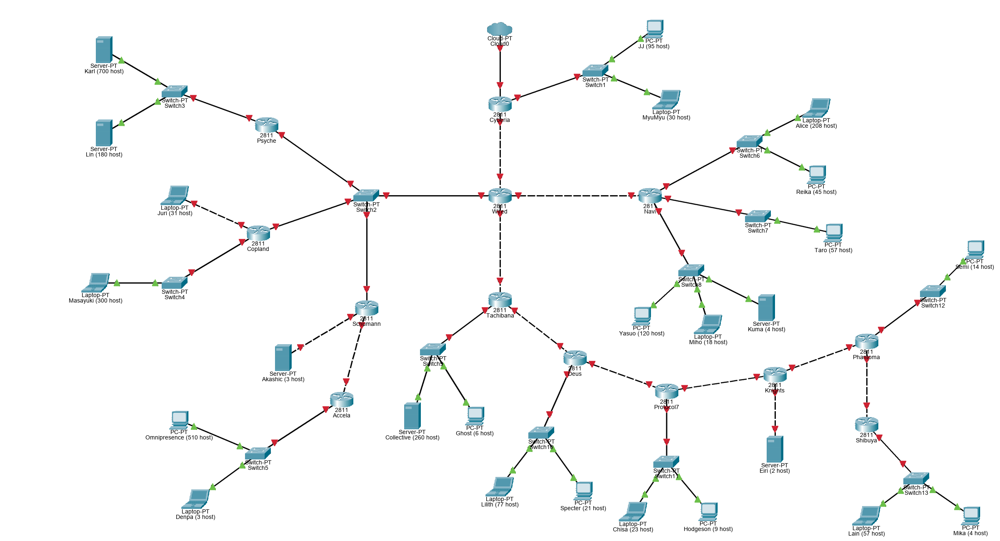
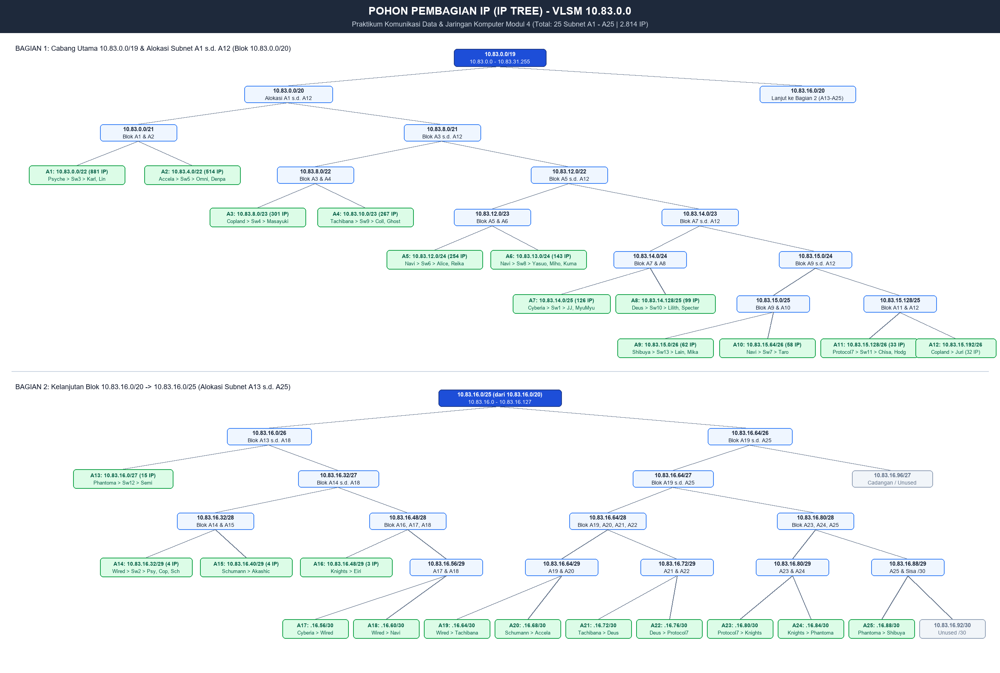
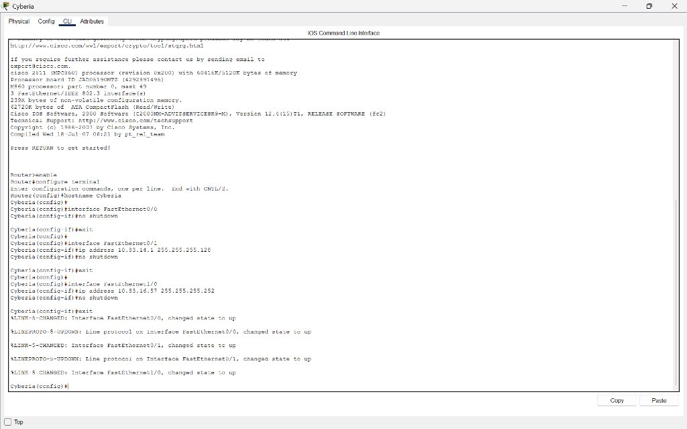
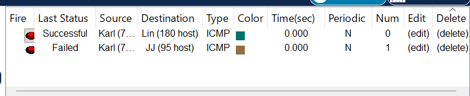
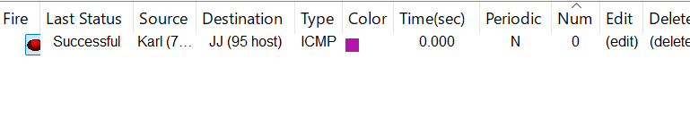
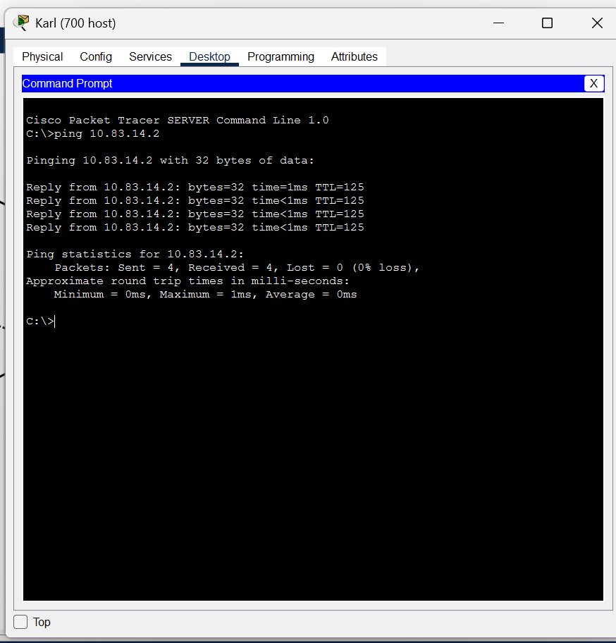

# Jarkom-Modul-4-2026-K-39

| Nama | NRP | Pengerjaan | 
|---|---|---|
| Asfia Fahmisan | 5027251043 | VLSM |
| Muhammad Atallah Mas'udi | 5027251071 | CIDR | 

---

## Topologi Jaringan

Pada praktikum Modul 4 ini (*Serial Experiments Lain — Layer:04: The Wired Expansion*), arsitektur jaringan *The Wired* dibangun berskala besar menggunakan metode pengalamatan *Classless* yang seefisien mungkin. Seluruh entitas dihubungkan melalui router utama **Cyberia** yang tersambung ke dunia luar (*Cloud* / NAT), mengalir ke hub **Wired**, kemudian bercabang ke kelompok router **Navi**, rantai **Tachibana** s.d. **Shibuya**, serta segmen bersama (*shared broadcast domain*) milik **Psyche**, **Copland**, dan **Schumann**:



### Parameter Global:
* **Prefix IP Kelompok K-39**: `10.83.0.0/16`
* **Metode Subnetting CPT**: VLSM (*Variable Length Subnet Masking*)
* **Upstream Internet (Cloud)**: Interface `FastEthernet1/0` pada router `Cyberia` terhubung ke `Cloud0` (CPT) / NAT (GNS3).
* **Jumlah Subnet**: 25 Subnet (`A1` s.d. `A25`)
* **Total Kebutuhan IP**: 2.814 IP (tanpa celah / *zero gap* dalam rentang `10.83.0.0/19`)
* **Total Perangkat**: 13 Router Cisco 2811, 13 Switch-PT, 25 Host (PC, Laptop, Server), 1 Cloud.

### Struktur Direktori Repository:
```text
├── VLSM-CPT/                              # Bagian 1: Simulasi VLSM (Cisco Packet Tracer)
│   ├── config_cpt/                       # Konfigurasi Cisco IOS CLI per-router & daftar IP host
│   │   ├── routers/                      # File skrip CLI (.txt) 13 router
│   │   └── daftar_ip_host_cpt.txt        # Tabel alokasi IP seluruh 25 host CPT
│   ├── script_bash/                      # Skrip otomatisasi environment Linux / GNS3
│   │   ├── hosts/                        # Skrip penetapan IP & gateway 25 host
│   │   ├── routers/                      # Skrip sysctl forward, flush, & static routing 13 router
│   │   ├── hitung_vlsm.sh                # Skrip kalkulator tree VLSM
│   │   └── test_ping_semua.sh            # Skrip matriks pengujian konektivitas antar-node
│   ├── Modul4_VLSM_10.83.pkt             # File Cisco Packet Tracer siap uji (VLSM 10.83)
│   ├── bagus.pkt                         # Salinan file CPT terverifikasi (full reachability)
│   ├── Template_Modul4_Kelompok_10.83.xlsx # Lembar kerja resmi perhitungan VLSM K-39
│   └── tree_pembagian_ip_vlsm_10.83.png  # Diagram visual pohon alokasi VLSM
├── CIDR/                                  # Bagian 2: Implementasi CIDR & Supernetting
│   ├── config/                           # Folder konfigurasi node skenario CIDR
│   ├── scripts/                          # Skrip routing supernetting CIDR
│   └── README.md                         # Panduan pengerjaan bagian CIDR
├── images/                               # Tangkapan layar bukti verifikasi & topologi
│   ├── cyberia_cli.jpg                   # Bukti eksekusi CLI Cyberia & routing table
│   ├── pdu_test.png                      # Bukti pengujian Simple PDU awal (Failed saat proses ARP)
│   ├── pdu_test_successful.png           # Bukti pengujian Simple PDU sukses (Successful setelah 4 hop ARP)
│   ├── pengujian_ping_cmd.png            # Bukti pengujian ping CLI Command Prompt PC Karl (0% loss)
│   ├── topo-modul4-cpt.png               # Tangkapan layar topologi CPT
│   ├── topo-modul4-gns.png               # Tangkapan layar topologi GNS3
│   └── tree_pembagian_ip_vlsm_10.83.png  # Diagram visual pohon alokasi VLSM
├── .gitignore                            # Filter file temporer Excel & OS
└── README.md                             # Laporan resmi praktikum Modul 4```

---

### Tabel Alokasi IP Address Host:
| Node | Interface | IP Address | Netmask | Gateway | Router Induk | Peran / Subnet |
| :--- | :--- | :--- | :--- | :--- | :--- | :--- |
| **Karl (700 host)** | FastEthernet0 | `10.83.0.2` | `255.255.252.0` | `10.83.0.1` | Psyche | Server (Subnet A1) |
| **Lin (180 host)** | FastEthernet0 | `10.83.0.3` | `255.255.252.0` | `10.83.0.1` | Psyche | Server (Subnet A1) |
| **Omnipresence (510 host)** | FastEthernet0 | `10.83.4.2` | `255.255.252.0` | `10.83.4.1` | Accela | PC (Subnet A2) |
| **Denpa (3 host)** | FastEthernet0 | `10.83.4.3` | `255.255.252.0` | `10.83.4.1` | Accela | Laptop (Subnet A2) |
| **Masayuki (300 host)** | FastEthernet0 | `10.83.8.2` | `255.255.254.0` | `10.83.8.1` | Copland | Laptop (Subnet A3) |
| **Collective (260 host)** | FastEthernet0 | `10.83.10.2` | `255.255.254.0` | `10.83.10.1` | Tachibana | Server (Subnet A4) |
| **Ghost (6 host)** | FastEthernet0 | `10.83.10.3` | `255.255.254.0` | `10.83.10.1` | Tachibana | PC (Subnet A4) |
| **Alice (208 host)** | FastEthernet0 | `10.83.12.2` | `255.255.255.0` | `10.83.12.1` | Navi | Laptop (Subnet A5) |
| **Reika (45 host)** | FastEthernet0 | `10.83.12.3` | `255.255.255.0` | `10.83.12.1` | Navi | PC (Subnet A5) |
| **Yasuo (120 host)** | FastEthernet0 | `10.83.13.2` | `255.255.255.0` | `10.83.13.1` | Navi | PC (Subnet A6) |
| **Miho (18 host)** | FastEthernet0 | `10.83.13.3` | `255.255.255.0` | `10.83.13.1` | Navi | Laptop (Subnet A6) |
| **Kuma (4 host)** | FastEthernet0 | `10.83.13.4` | `255.255.255.0` | `10.83.13.1` | Navi | Server (Subnet A6) |
| **JJ (95 host)** | FastEthernet0 | `10.83.14.2` | `255.255.255.128` | `10.83.14.1` | Cyberia | PC (Subnet A7) |
| **MyuMyu (30 host)** | FastEthernet0 | `10.83.14.3` | `255.255.255.128` | `10.83.14.1` | Cyberia | Laptop (Subnet A7) |
| **Lilith (77 host)** | FastEthernet0 | `10.83.14.130` | `255.255.255.128` | `10.83.14.129` | Deus | Laptop (Subnet A8) |
| **Specter (21 host)** | FastEthernet0 | `10.83.14.131` | `255.255.255.128` | `10.83.14.129` | Deus | PC (Subnet A8) |
| **Lain (57 host)** | FastEthernet0 | `10.83.15.2` | `255.255.255.192` | `10.83.15.1` | Shibuya | Laptop (Subnet A9) |
| **Mika (4 host)** | FastEthernet0 | `10.83.15.3` | `255.255.255.192` | `10.83.15.1` | Shibuya | PC (Subnet A9) |
| **Taro (57 host)** | FastEthernet0 | `10.83.15.66` | `255.255.255.192` | `10.83.15.65` | Navi | PC (Subnet A10) |
| **Chisa (23 host)** | FastEthernet0 | `10.83.15.130` | `255.255.255.192` | `10.83.15.129` | Protocol7 | Laptop (Subnet A11) |
| **Hodgeson (9 host)** | FastEthernet0 | `10.83.15.131` | `255.255.255.192` | `10.83.15.129` | Protocol7 | PC (Subnet A11) |
| **Juri (31 host)** | FastEthernet0 | `10.83.15.194` | `255.255.255.192` | `10.83.15.193` | Copland | Laptop (Subnet A12) |
| **Semi (14 host)** | FastEthernet0 | `10.83.16.2` | `255.255.255.224` | `10.83.16.1` | Phantoma | PC (Subnet A13) |
| **Akashic (3 host)** | FastEthernet0 | `10.83.16.42` | `255.255.255.248` | `10.83.16.41` | Schumann | Server (Subnet A15) |
| **Eiri (2 host)** | FastEthernet0 | `10.83.16.50` | `255.255.255.248` | `10.83.16.49` | Knights | Server (Subnet A16) |

---

### Tabel Alokasi IP Address Interface Router:
| Router | Interface | IP Address | Subnet Mask | Keterangan Sambungan |
| :--- | :--- | :--- | :--- | :--- |
| **Cyberia** | `FastEthernet0/0`<br>`FastEthernet0/1`<br>`FastEthernet1/0` | `10.83.16.57`<br>`10.83.14.1`<br>- | `255.255.255.252`<br>`255.255.255.128`<br>- | Point-to-point ke Wired (A17)<br>LAN Switch1: JJ & MyuMyu (A7)<br>Uplink ke Cloud0 |
| **Wired** | `FastEthernet0/0`<br>`FastEthernet0/1`<br>`FastEthernet1/0`<br>`FastEthernet1/1` | `10.83.16.58`<br>`10.83.16.33`<br>`10.83.16.61`<br>`10.83.16.65` | `255.255.255.252`<br>`255.255.255.248`<br>`255.255.255.252`<br>`255.255.255.252` | Point-to-point ke Cyberia (A17)<br>Shared Switch2 ke Psyche, Copland, Schumann (A14)<br>Point-to-point ke Navi (A18)<br>Point-to-point ke Tachibana (A19) |
| **Navi** | `FastEthernet0/0`<br>`FastEthernet0/1`<br>`FastEthernet1/0`<br>`FastEthernet1/1` | `10.83.16.62`<br>`10.83.12.1`<br>`10.83.15.65`<br>`10.83.13.1` | `255.255.255.252`<br>`255.255.255.0`<br>`255.255.255.192`<br>`255.255.255.0` | Point-to-point ke Wired (A18)<br>LAN Switch6: Alice & Reika (A5)<br>LAN Switch7: Taro (A10)<br>LAN Switch8: Yasuo, Miho, Kuma (A6) |
| **Psyche** | `FastEthernet0/0`<br>`FastEthernet0/1` | `10.83.16.34`<br>`10.83.0.1` | `255.255.255.248`<br>`255.255.252.0` | Shared Switch2 dari Wired (A14)<br>LAN Switch3: Karl & Lin (A1) |
| **Copland** | `FastEthernet0/0`<br>`FastEthernet0/1`<br>`FastEthernet1/0` | `10.83.16.35`<br>`10.83.8.1`<br>`10.83.15.193` | `255.255.255.248`<br>`255.255.254.0`<br>`255.255.255.192` | Shared Switch2 dari Wired (A14)<br>LAN Switch4: Masayuki (A3)<br>Direct Link ke Juri (A12) |
| **Schumann** | `FastEthernet0/0`<br>`FastEthernet0/1`<br>`FastEthernet1/0` | `10.83.16.36`<br>`10.83.16.41`<br>`10.83.16.69` | `255.255.255.248`<br>`255.255.255.248`<br>`255.255.255.252` | Shared Switch2 dari Wired (A14)<br>Direct Link ke Akashic (A15)<br>Point-to-point ke Accela (A20) |
| **Accela** | `FastEthernet0/0`<br>`FastEthernet0/1` | `10.83.16.70`<br>`10.83.4.1` | `255.255.255.252`<br>`255.255.252.0` | Point-to-point ke Schumann (A20)<br>LAN Switch5: Omnipresence & Denpa (A2) |
| **Tachibana** | `FastEthernet0/0`<br>`FastEthernet0/1`<br>`FastEthernet1/0` | `10.83.16.66`<br>`10.83.10.1`<br>`10.83.16.73` | `255.255.255.252`<br>`255.255.254.0`<br>`255.255.255.252` | Point-to-point ke Wired (A19)<br>LAN Switch9: Collective & Ghost (A4)<br>Point-to-point ke Deus (A21) |
| **Deus** | `FastEthernet0/0`<br>`FastEthernet0/1`<br>`FastEthernet1/0` | `10.83.16.74`<br>`10.83.14.129`<br>`10.83.16.77` | `255.255.255.252`<br>`255.255.255.128`<br>`255.255.255.252` | Point-to-point ke Tachibana (A21)<br>LAN Switch10: Lilith & Specter (A8)<br>Point-to-point ke Protocol7 (A22) |
| **Protocol7** | `FastEthernet0/0`<br>`FastEthernet0/1`<br>`FastEthernet1/0` | `10.83.16.78`<br>`10.83.15.129`<br>`10.83.16.81` | `255.255.255.252`<br>`255.255.255.192`<br>`255.255.255.252` | Point-to-point ke Deus (A22)<br>LAN Switch11: Chisa & Hodgeson (A11)<br>Point-to-point ke Knights (A23) |
| **Knights** | `FastEthernet0/0`<br>`FastEthernet0/1`<br>`FastEthernet1/0` | `10.83.16.82`<br>`10.83.16.49`<br>`10.83.16.85` | `255.255.255.252`<br>`255.255.255.248`<br>`255.255.255.252` | Point-to-point ke Protocol7 (A23)<br>Direct Link ke Eiri (A16)<br>Point-to-point ke Phantoma (A24) |
| **Phantoma** | `FastEthernet0/0`<br>`FastEthernet0/1`<br>`FastEthernet1/0` | `10.83.16.86`<br>`10.83.16.1`<br>`10.83.16.89` | `255.255.255.252`<br>`255.255.255.224`<br>`255.255.255.252` | Point-to-point ke Knights (A24)<br>LAN Switch12: Semi (A13)<br>Point-to-point ke Shibuya (A25) |
| **Shibuya** | `FastEthernet0/0`<br>`FastEthernet0/1` | `10.83.16.90`<br>`10.83.15.1` | `255.255.255.252`<br>`255.255.255.192` | Point-to-point ke Phantoma (A25)<br>LAN Switch13: Lain & Mika (A9) |

---

## Soal 1

Identifikasi seluruh segmen jaringan pada topologi The Wired, tentukan jumlah host pada tiap node, dan hitung kebutuhan IP riil untuk masing-masing subnet dengan menjumlahkan total host dan jumlah interface router yang terhubung pada subnet tersebut. Urutkan seluruh subnet dari kebutuhan terbesar ke terkecil sebagai landasan perhitungan VLSM.

### Konfigurasi dan Penjelasan:
Sesuai ketentuan praktikum, setiap interface router yang bertindak sebagai *default gateway* atau penghubung antar-node dihitung sebagai 1 kebutuhan IP. Khusus untuk subnet bersama `A14` (`Wired > Switch2 > Psyche, Copland, Schumann`), terdapat 4 interface router yang berada dalam satu *broadcast domain* yang sama sehingga kebutuhan IP-nya bernilai 4.

Urutan kebutuhan IP terbesar ke terkecil:
1. `A1` (881 IP) $\rightarrow$ 700 (Karl) + 180 (Lin) + 1 router
2. `A2` (514 IP) $\rightarrow$ 510 (Omnipresence) + 3 (Denpa) + 1 router
3. `A3` (301 IP) $\rightarrow$ 300 (Masayuki) + 1 router
4. `A4` (267 IP) $\rightarrow$ 260 (Collective) + 6 (Ghost) + 1 router
5. `A5` (254 IP) $\rightarrow$ 208 (Alice) + 45 (Reika) + 1 router
6. `A6` (143 IP) $\rightarrow$ 120 (Yasuo) + 18 (Miho) + 4 (Kuma) + 1 router
7. `A7` (126 IP) $\rightarrow$ 95 (JJ) + 30 (MyuMyu) + 1 router
8. `A8` (99 IP) $\rightarrow$ 77 (Lilith) + 21 (Specter) + 1 router
9. `A9` (62 IP) $\rightarrow$ 57 (Lain) + 4 (Mika) + 1 router
10. `A10` (58 IP) $\rightarrow$ 57 (Taro) + 1 router
11. `A11` (33 IP) $\rightarrow$ 23 (Chisa) + 9 (Hodgeson) + 1 router
12. `A12` (32 IP) $\rightarrow$ 31 (Juri) + 1 router
13. `A13` (15 IP) $\rightarrow$ 14 (Semi) + 1 router
14. `A14` (4 IP) $\rightarrow$ 4 router interface
15. `A15` (4 IP) $\rightarrow$ 3 (Akashic) + 1 router
16. `A16` (3 IP) $\rightarrow$ 2 (Eiri) + 1 router
17. `A17` s.d. `A25` (masing-masing 2 IP) $\rightarrow$ Point-to-point 2 router interface.

Total alokasi alamat yang dibutuhkan adalah **2.814 IP**.

### Bukti Verifikasi:
Lembar perhitungan alokasi subnet dapat diakses online melalui [Google Spreadsheet Resmi Kelompok K-39](https://docs.google.com/spreadsheets/d/1XlCe701xFm7mK43r-sJaImQ2owLYlwCm/edit?usp=sharing&ouid=116660344884914721699&rtpof=true&sd=true) atau file lokal [Template_Modul4_Kelompok_10.83.xlsx](VLSM-CPT/Template_Modul4_Kelompok_10.83.xlsx):

| Kode | Subnet / Rute | Total Kebutuhan | Prefix | Netmask |
| :---: | :--- | :---: | :---: | :--- |
| **A1** | Psyche > Switch3 > Karl, Lin | 881 | `/22` | `255.255.252.0` |
| **A2** | Accela > Switch5 > Omnipresence, Denpa | 514 | `/22` | `255.255.252.0` |
| **A3** | Copland > Switch4 > Masayuki | 301 | `/23` | `255.255.254.0` |
| **A4** | Tachibana > Switch9 > Collective, Ghost | 267 | `/23` | `255.255.254.0` |
| **A5** | Navi > Switch6 > Alice, Reika | 254 | `/24` | `255.255.255.0` |
| **A6** | Navi > Switch8 > Yasuo, Miho, Kuma | 143 | `/24` | `255.255.255.0` |
| **A7** | Cyberia > Switch1 > JJ, MyuMyu | 126 | `/25` | `255.255.255.128` |
| **A8** | Deus > Switch10 > Lilith, Specter | 99 | `/25` | `255.255.255.128` |
| **A9** | Shibuya > Switch13 > Lain, Mika | 62 | `/26` | `255.255.255.192` |
| **A10** | Navi > Switch7 > Taro | 58 | `/26` | `255.255.255.192` |
| **A11** | Protocol7 > Switch11 > Chisa, Hodgeson | 33 | `/26` | `255.255.255.192` |
| **A12** | Copland > Juri | 32 | `/26` | `255.255.255.192` |
| **A13** | Phantoma > Switch12 > Semi | 15 | `/27` | `255.255.255.224` |
| **A14** | Wired > Switch2 > Psyche, Copland, Schumann | 4 | `/29` | `255.255.255.248` |
| **A15** | Schumann > Akashic | 4 | `/29` | `255.255.255.248` |
| **A16** | Knights > Eiri | 3 | `/29` | `255.255.255.248` |
| **A17 - A25** | Point-to-Point Link Antar Router | 2 (tiap link) | `/30` | `255.255.255.252` |

---

## Soal 2

Susun struktur pohon biner pembagian alamat IP (*VLSM Subnet Tree*) berbasis blok alamat kelompok 10.83.0.0/19. Tunjukkan hierarki pemecahan blok besar menjadi subnet-subnet yang lebih kecil tanpa celah (*zero gap*) sehingga tidak ada alamat yang terbuang.

### Konfigurasi dan Penjelasan:
Blok alamat awal yang mencakup seluruh kebutuhan adalah `10.83.0.0/19` (total 8.192 alamat):
1. Dibagi dua menjadi `10.83.0.0/20` (untuk `A1` s.d. `A12`) dan `10.83.16.0/20` (untuk `A13` s.d. `A25`).
2. `10.83.0.0/20` dipecah lagi menjadi dua `/21`:
   - `10.83.0.0/21` dipecah menjadi `A1` (`10.83.0.0/22`) dan `A2` (`10.83.4.0/22`).
   - `10.83.8.0/21` dipecah menjadi `A3` (`10.83.8.0/23`) dan `A4` (`10.83.10.0/23`), kemudian `/22` berikutnya dipecah untuk `A5`, `A6`, `A7`, `A8`, `A9`, `A10`, `A11`, dan `A12`.
3. Blok `10.83.16.0/20` dipecah untuk menampung subnet-subnet kecil: `A13` (`/27`), `A14` s.d. `A16` (`/29`), serta `A17` s.d. `A25` (`/30`).

### Bukti Verifikasi:
Diagram Pohon Pembagian IP VLSM:



---

## Soal 3

Rancang tabel subnetting VLSM lengkap yang memuat Subnet ID, Subnet Mask, Range Usable IP Host, Broadcast IP, serta kapasitas usable untuk ke-25 subnet.

### Konfigurasi dan Penjelasan:
Penomoran IP dibuat berurutan rapat tanpa ada celah (*contiguous zero gap*). Subnet pertama `A1` dimulai tepat pada `10.83.0.0`, dan subnet terakhir `A25` berakhir pada `10.83.16.91`.

### Bukti Verifikasi:
Tabel VLSM Lengkap:

| Kode | Subnet ID | Subnet Mask | Range Usable IP Host | Broadcast IP | Kapasitas |
| :---: | :--- | :--- | :--- | :--- | :---: |
| **A1** | `10.83.0.0` | `255.255.252.0` | `10.83.0.1 - 10.83.3.254` | `10.83.3.255` | 1022 |
| **A2** | `10.83.4.0` | `255.255.252.0` | `10.83.4.1 - 10.83.7.254` | `10.83.7.255` | 1022 |
| **A3** | `10.83.8.0` | `255.255.254.0` | `10.83.8.1 - 10.83.9.254` | `10.83.9.255` | 510 |
| **A4** | `10.83.10.0` | `255.255.254.0` | `10.83.10.1 - 10.83.11.254` | `10.83.11.255` | 510 |
| **A5** | `10.83.12.0` | `255.255.255.0` | `10.83.12.1 - 10.83.12.254` | `10.83.12.255` | 254 |
| **A6** | `10.83.13.0` | `255.255.255.0` | `10.83.13.1 - 10.83.13.254` | `10.83.13.255` | 254 |
| **A7** | `10.83.14.0` | `255.255.255.128` | `10.83.14.1 - 10.83.14.126` | `10.83.14.127` | 126 |
| **A8** | `10.83.14.128` | `255.255.255.128` | `10.83.14.129 - 10.83.14.254` | `10.83.14.255` | 126 |
| **A9** | `10.83.15.0` | `255.255.255.192` | `10.83.15.1 - 10.83.15.62` | `10.83.15.63` | 62 |
| **A10** | `10.83.15.64` | `255.255.255.192` | `10.83.15.65 - 10.83.15.126` | `10.83.15.127` | 62 |
| **A11** | `10.83.15.128` | `255.255.255.192` | `10.83.15.129 - 10.83.15.190` | `10.83.15.191` | 62 |
| **A12** | `10.83.15.192` | `255.255.255.192` | `10.83.15.193 - 10.83.15.254` | `10.83.15.255` | 62 |
| **A13** | `10.83.16.0` | `255.255.255.224` | `10.83.16.1 - 10.83.16.30` | `10.83.16.31` | 30 |
| **A14** | `10.83.16.32` | `255.255.255.248` | `10.83.16.33 - 10.83.16.38` | `10.83.16.39` | 6 |
| **A15** | `10.83.16.40` | `255.255.255.248` | `10.83.16.41 - 10.83.16.46` | `10.83.16.47` | 6 |
| **A16** | `10.83.16.48` | `255.255.255.248` | `10.83.16.49 - 10.83.16.54` | `10.83.16.55` | 6 |
| **A17** | `10.83.16.56` | `255.255.255.252` | `10.83.16.57 - 10.83.16.58` | `10.83.16.59` | 2 |
| **A18** | `10.83.16.60` | `255.255.255.252` | `10.83.16.61 - 10.83.16.62` | `10.83.16.63` | 2 |
| **A19** | `10.83.16.64` | `255.255.255.252` | `10.83.16.65 - 10.83.16.66` | `10.83.16.67` | 2 |
| **A20** | `10.83.16.68` | `255.255.255.252` | `10.83.16.69 - 10.83.16.70` | `10.83.16.71` | 2 |
| **A21** | `10.83.16.72` | `255.255.255.252` | `10.83.16.73 - 10.83.16.74` | `10.83.16.75` | 2 |
| **A22** | `10.83.16.76` | `255.255.255.252` | `10.83.16.77 - 10.83.16.78` | `10.83.16.79` | 2 |
| **A23** | `10.83.16.80` | `255.255.255.252` | `10.83.16.81 - 10.83.16.82` | `10.83.16.83` | 2 |
| **A24** | `10.83.16.84` | `255.255.255.252` | `10.83.16.85 - 10.83.16.86` | `10.83.16.87` | 2 |
| **A25** | `10.83.16.88` | `255.255.255.252` | `10.83.16.89 - 10.83.16.90` | `10.83.16.91` | 2 |

---

## Soal 4

Konfigurasikan router utama Cyberia dan hub sentral Wired. Cyberia berfungsi sebagai gerbang utama penghubung Cloud dan LAN A7, sedangkan Wired mendistribusikan lalu lintas ke seluruh cabang jaringan. Pasang rute statis seefisien mungkin dengan memanfaatkan rute default dan supernetting/agregasi.

### Konfigurasi dan Penjelasan:
- **Cyberia**: Memiliki rute langsung ke `A7` (`10.83.14.0/25`) dan link `A17` ke Wired. Semua lalu lintas menuju subnet lainnya dialihkan ke Wired melalui rute default `0.0.0.0 0.0.0.0 10.83.16.58`.
- **Wired**: Mengarahkan paket ke cabang kiri melalui next-hop di Switch2 (`10.83.16.34` untuk Psyche, `10.83.16.35` untuk Copland, `10.83.16.36` untuk Schumann/Accela), ke cabang kanan melalui Navi (`10.83.16.62`), dan ke rantai bawah melalui Tachibana (`10.83.16.66`).

### Bukti Verifikasi & Skrip CLI:

#### Skrip CLI Router Cyberia:
```cisco
enable
configure terminal
hostname Cyberia
interface FastEthernet0/0
ip address 10.83.16.57 255.255.255.252
no shutdown
exit
interface FastEthernet0/1
ip address 10.83.14.1 255.255.255.128
no shutdown
exit
ip route 0.0.0.0 0.0.0.0 10.83.16.58
end
write memory
```

#### Skrip CLI Router Wired:
```cisco
enable
configure terminal
hostname Wired
interface FastEthernet0/0
ip address 10.83.16.58 255.255.255.252
no shutdown
exit
interface FastEthernet0/1
ip address 10.83.16.33 255.255.255.248
no shutdown
exit
interface FastEthernet1/0
ip address 10.83.16.61 255.255.255.252
no shutdown
exit
interface FastEthernet1/1
ip address 10.83.16.65 255.255.255.252
no shutdown
exit
ip route 10.83.14.0 255.255.255.128 10.83.16.57
ip route 10.83.0.0 255.255.252.0 10.83.16.34
ip route 10.83.8.0 255.255.254.0 10.83.16.35
ip route 10.83.15.192 255.255.255.192 10.83.16.35
ip route 10.83.4.0 255.255.252.0 10.83.16.36
ip route 10.83.16.40 255.255.255.248 10.83.16.36
ip route 10.83.16.68 255.255.255.252 10.83.16.36
ip route 10.83.12.0 255.255.254.0 10.83.16.62
ip route 10.83.15.64 255.255.255.192 10.83.16.62
ip route 10.83.10.0 255.255.254.0 10.83.16.66
ip route 10.83.14.128 255.255.255.128 10.83.16.66
ip route 10.83.15.0 255.255.255.192 10.83.16.66
ip route 10.83.15.128 255.255.255.192 10.83.16.66
ip route 10.83.16.0 255.255.255.224 10.83.16.66
ip route 10.83.16.48 255.255.255.248 10.83.16.66
ip route 10.83.16.72 255.255.255.248 10.83.16.66
ip route 10.83.16.80 255.255.255.240 10.83.16.66
end
write memory
```

Tampilan status antarmuka dan rute statis pada router Cyberia:



---

## Soal 5

Konfigurasikan router-router cabang kiri: Psyche, Copland, Schumann, dan Accela yang terhubung melalui Switch2 (Subnet A14). Pastikan komunikasi antar-router dalam segmen A14 serta rute balik ke seluruh jaringan Wired berjalan tanpa loop.

### Konfigurasi dan Penjelasan:
Keempat router ini berbagi subnet `10.83.16.32/29` pada Switch2:
- **Psyche** (`.34`): Mengarahkan paket ke LAN Copland (`.35`) dan Schumann/Accela (`.36`), serta rute default `0.0.0.0 0.0.0.0 10.83.16.33` kembali ke Wired.
- **Copland** (`.35`): Melayani LAN A3 (Masayuki) dan A12 (Juri), serta rute balik ke Wired.
- **Schumann** (`.36`): Menghubungkan host Akashic (A15) dan meneruskan paket ke Accela (`10.83.16.70`) melalui link A20 (`10.83.16.68/30`).
- **Accela** (`.70`): Melayani LAN A2 (Omnipresence dan Denpa) dengan rute default menuju Schumann (`10.83.16.69`).

### Bukti Verifikasi & Skrip CLI:

#### Skrip CLI Router Psyche:
```cisco
enable
configure terminal
hostname Psyche
interface FastEthernet0/0
ip address 10.83.16.34 255.255.255.248
no shutdown
exit
interface FastEthernet0/1
ip address 10.83.0.1 255.255.252.0
no shutdown
exit
ip route 10.83.8.0 255.255.254.0 10.83.16.35
ip route 10.83.15.192 255.255.255.192 10.83.16.35
ip route 10.83.4.0 255.255.252.0 10.83.16.36
ip route 10.83.16.40 255.255.255.248 10.83.16.36
ip route 10.83.16.68 255.255.255.252 10.83.16.36
ip route 0.0.0.0 0.0.0.0 10.83.16.33
end
write memory
```

#### Skrip CLI Router Copland:
```cisco
enable
configure terminal
hostname Copland
interface FastEthernet0/0
ip address 10.83.16.35 255.255.255.248
no shutdown
exit
interface FastEthernet0/1
ip address 10.83.8.1 255.255.254.0
no shutdown
exit
interface FastEthernet1/0
ip address 10.83.15.193 255.255.255.192
no shutdown
exit
ip route 10.83.0.0 255.255.252.0 10.83.16.34
ip route 10.83.4.0 255.255.252.0 10.83.16.36
ip route 10.83.16.40 255.255.255.248 10.83.16.36
ip route 10.83.16.68 255.255.255.252 10.83.16.36
ip route 0.0.0.0 0.0.0.0 10.83.16.33
end
write memory
```

#### Skrip CLI Router Schumann:
```cisco
enable
configure terminal
hostname Schumann
interface FastEthernet0/0
ip address 10.83.16.36 255.255.255.248
no shutdown
exit
interface FastEthernet0/1
ip address 10.83.16.41 255.255.255.248
no shutdown
exit
interface FastEthernet1/0
ip address 10.83.16.69 255.255.255.252
no shutdown
exit
ip route 10.83.4.0 255.255.252.0 10.83.16.70
ip route 10.83.0.0 255.255.252.0 10.83.16.34
ip route 10.83.8.0 255.255.254.0 10.83.16.35
ip route 10.83.15.192 255.255.255.192 10.83.16.35
ip route 0.0.0.0 0.0.0.0 10.83.16.33
end
write memory
```

#### Skrip CLI Router Accela:
```cisco
enable
configure terminal
hostname Accela
interface FastEthernet0/0
ip address 10.83.16.70 255.255.255.252
no shutdown
exit
interface FastEthernet0/1
ip address 10.83.4.1 255.255.252.0
no shutdown
exit
ip route 0.0.0.0 0.0.0.0 10.83.16.69
end
write memory
```

---

## Soal 6

Konfigurasikan router Navi sebagai gerbang cabang timur yang melayani tiga segmen LAN: Switch6 (A5), Switch7 (A10), dan Switch8 (A6).

### Konfigurasi dan Penjelasan:
Navi terhubung langsung ke Wired melalui link point-to-point `A18` (`10.83.16.60/30`). Karena Navi hanya memiliki satu jalur keluar masuk (*stub network*), seluruh paket ke luar jaringan lokalnya cukup diarahkan melalui satu rute default `0.0.0.0 0.0.0.0 10.83.16.61` ke router Wired.

### Bukti Verifikasi & Skrip CLI:

#### Skrip CLI Router Navi:
```cisco
enable
configure terminal
hostname Navi
interface FastEthernet0/0
ip address 10.83.16.62 255.255.255.252
no shutdown
exit
interface FastEthernet0/1
ip address 10.83.12.1 255.255.255.0
no shutdown
exit
interface FastEthernet1/0
ip address 10.83.15.65 255.255.255.192
no shutdown
exit
interface FastEthernet1/1
ip address 10.83.13.1 255.255.255.0
no shutdown
exit
ip route 0.0.0.0 0.0.0.0 10.83.16.61
end
write memory
```

---

## Soal 7

Konfigurasikan rantai router selatan secara serial: Tachibana $\rightarrow$ Deus $\rightarrow$ Protocol7 $\rightarrow$ Knights $\rightarrow$ Phantoma $\rightarrow$ Shibuya. Setiap router melayani LAN lokalnya masing-masing serta meneruskan lalu lintas antar-hop secara bolak-balik tanpa adanya paket yang terputus di tengah jalan.

### Konfigurasi dan Penjelasan:
Setiap router pada rantai ini memiliki:
1. Jalur maju (*forward path*): Mengarahkan paket ke router berikutnya lebih dalam hingga mencapai Shibuya.
2. Jalur kembali (*return path*): Rute default `0.0.0.0 0.0.0.0` mengarah ke router sebelumnya menuju Wired.

### Bukti Verifikasi & Skrip CLI:

#### Skrip CLI Router Tachibana:
```cisco
enable
configure terminal
hostname Tachibana
interface FastEthernet0/0
ip address 10.83.16.66 255.255.255.252
no shutdown
exit
interface FastEthernet0/1
ip address 10.83.10.1 255.255.254.0
no shutdown
exit
interface FastEthernet1/0
ip address 10.83.16.73 255.255.255.252
no shutdown
exit
ip route 10.83.14.128 255.255.255.128 10.83.16.74
ip route 10.83.15.0 255.255.255.192 10.83.16.74
ip route 10.83.15.128 255.255.255.192 10.83.16.74
ip route 10.83.16.0 255.255.255.224 10.83.16.74
ip route 10.83.16.48 255.255.255.248 10.83.16.74
ip route 10.83.16.76 255.255.255.252 10.83.16.74
ip route 10.83.16.80 255.255.255.240 10.83.16.74
ip route 0.0.0.0 0.0.0.0 10.83.16.65
end
write memory
```

#### Skrip CLI Router Deus:
```cisco
enable
configure terminal
hostname Deus
interface FastEthernet0/0
ip address 10.83.16.74 255.255.255.252
no shutdown
exit
interface FastEthernet0/1
ip address 10.83.14.129 255.255.255.128
no shutdown
exit
interface FastEthernet1/0
ip address 10.83.16.77 255.255.255.252
no shutdown
exit
ip route 10.83.15.0 255.255.255.192 10.83.16.78
ip route 10.83.15.128 255.255.255.192 10.83.16.78
ip route 10.83.16.0 255.255.255.224 10.83.16.78
ip route 10.83.16.48 255.255.255.248 10.83.16.78
ip route 10.83.16.80 255.255.255.240 10.83.16.78
ip route 0.0.0.0 0.0.0.0 10.83.16.73
end
write memory
```

#### Skrip CLI Router Protocol7:
```cisco
enable
configure terminal
hostname Protocol7
interface FastEthernet0/0
ip address 10.83.16.78 255.255.255.252
no shutdown
exit
interface FastEthernet0/1
ip address 10.83.15.129 255.255.255.192
no shutdown
exit
interface FastEthernet1/0
ip address 10.83.16.81 255.255.255.252
no shutdown
exit
ip route 10.83.15.0 255.255.255.192 10.83.16.82
ip route 10.83.16.0 255.255.255.224 10.83.16.82
ip route 10.83.16.48 255.255.255.248 10.83.16.82
ip route 10.83.16.84 255.255.255.252 10.83.16.82
ip route 10.83.16.88 255.255.255.252 10.83.16.82
ip route 0.0.0.0 0.0.0.0 10.83.16.77
end
write memory
```

#### Skrip CLI Router Knights:
```cisco
enable
configure terminal
hostname Knights
interface FastEthernet0/0
ip address 10.83.16.82 255.255.255.252
no shutdown
exit
interface FastEthernet0/1
ip address 10.83.16.49 255.255.255.248
no shutdown
exit
interface FastEthernet1/0
ip address 10.83.16.85 255.255.255.252
no shutdown
exit
ip route 10.83.15.0 255.255.255.192 10.83.16.86
ip route 10.83.16.0 255.255.255.224 10.83.16.86
ip route 10.83.16.88 255.255.255.252 10.83.16.86
ip route 0.0.0.0 0.0.0.0 10.83.16.81
end
write memory
```

#### Skrip CLI Router Phantoma:
```cisco
enable
configure terminal
hostname Phantoma
interface FastEthernet0/0
ip address 10.83.16.86 255.255.255.252
no shutdown
exit
interface FastEthernet0/1
ip address 10.83.16.1 255.255.255.224
no shutdown
exit
interface FastEthernet1/0
ip address 10.83.16.89 255.255.255.252
no shutdown
exit
ip route 10.83.15.0 255.255.255.192 10.83.16.90
ip route 0.0.0.0 0.0.0.0 10.83.16.85
end
write memory
```

#### Skrip CLI Router Shibuya:
```cisco
enable
configure terminal
hostname Shibuya
interface FastEthernet0/0
ip address 10.83.16.90 255.255.255.252
no shutdown
exit
interface FastEthernet0/1
ip address 10.83.15.1 255.255.255.192
no shutdown
exit
ip route 0.0.0.0 0.0.0.0 10.83.16.89
end
write memory
```

---

## Soal 8

Tetapkan konfigurasi pengalamatan statis pada seluruh 25 host (PC, Laptop, Server). Pastikan setiap host menerima IP usable pertama setelah IP router, subnet mask yang sesuai dengan ukuran subnetnya, serta default gateway yang tepat mengarah ke router gateway lokalnya.

### Konfigurasi dan Penjelasan:
Seluruh 25 host dikonfigurasi melalui menu **Desktop $\rightarrow$ IP Configuration** pada Cisco Packet Tracer (atau file teks [daftar_ip_host_cpt.txt](VLSM-CPT/config_cpt/daftar_ip_host_cpt.txt)). Tidak ada host yang bentrok (*IP conflict*) dan seluruh gateway mengarah tepat ke IP antarmuka router pada segmennya.

### Bukti Verifikasi:
Contoh konfigurasi IP host pada PC `Karl (700 host)`:
- IP Address: `10.83.0.2`
- Subnet Mask: `255.255.252.0`
- Default Gateway: `10.83.0.1`

Contoh konfigurasi IP host pada PC `JJ (95 host)`:
- IP Address: `10.83.14.2`
- Subnet Mask: `255.255.255.128`
- Default Gateway: `10.83.14.1`

---

## Soal 9

Lakukan pengujian konektivitas end-to-end antar-subnet dan dalam subnet (*intra-subnet* dan *inter-subnet*). Analisis perilaku protokol ARP (*Address Resolution Protocol*) dan STP (*Spanning Tree Protocol*) di Cisco Packet Tracer yang menyebabkan pengiriman paket pertama berstatus "Failed".

### Konfigurasi dan Penjelasan:
Pada pengujian konektivitas end-to-end:
1. **Intra-Subnet (Dalam 1 Subnet)**:
   Pengujian antara `Karl (700 host)` menuju `Lin (180 host)` pada Subnet `A1` langsung berstatus **Successful** pada percobaan pertama (`Num 0`) karena kedua host berada pada switch yang sama (`Switch3`) tanpa melewati proses routing antar-hop.
2. **Inter-Subnet (Lintas Subnet / Beda Router - Kasus Karl menuju JJ)**:
   Jalur komunikasi antara `Karl (700 host)` di cabang Psyche menuju `JJ (95 host)` di cabang Cyberia melewati 3 router dan 4 segmen/hop:
   $$\text{Karl} \xrightarrow{\text{Hop 1}} \text{Psyche} \xrightarrow{\text{Hop 2}} \text{Wired} \xrightarrow{\text{Hop 3}} \text{Cyberia} \xrightarrow{\text{Hop 4}} \text{JJ}$$
   - **Mekanisme Multi-Hop ARP Drop**: Pada sistem Cisco IOS, jika router menerima paket IP menuju next-hop yang belum tercatat pada tabel ARP (*ARP Cache*), router akan menahan broadcast *ARP Request* dan langsung membuang (*drop*) paket ICMP yang sedang mengantre (karena buffer ICMP Cisco IOS tidak menahan paket selama proses ARP resolution).
   - **Kenapa Butuh 4 Kali Klik Fire / Percobaan?**
     Amplop *Simple PDU* (`P`) pada Cisco Packet Tracer hanya mengirimkan **1 paket ICMP Echo Request** per klik:
     * **Klik ke-1**: Mengisi ARP tabel antara `Karl` $\leftrightarrow$ `Psyche` (Hop 1). Paket ICMP pertama dibuang $\rightarrow$ Status: `Failed`.
     * **Klik ke-2**: Paket lolos ke `Psyche`, namun `Psyche` belum memiliki MAC `Wired` pada Subnet A14 (Hop 2). Paket dibuang untuk ARP $\rightarrow$ Status: `Failed`.
     * **Klik ke-3**: Paket lolos ke `Wired`, namun `Wired` belum memiliki MAC `Cyberia` pada Subnet A21 (Hop 3). Paket dibuang untuk ARP $\rightarrow$ Status: `Failed`.
     * **Klik ke-4**: Seluruh hop hingga `Cyberia` $\leftrightarrow$ `JJ` (Hop 4) telah berhasil memetakan MAC address. Paket ICMP Echo Request sampai ke tujuan dan dibalas dengan ICMP Echo Reply secara utuh $\rightarrow$ Status berubah menjadi **`Successful`**!

### Bukti Verifikasi:

#### 1. Pengujian Simple PDU (Percobaan Awal vs Setelah Multi-Hop ARP Resolution):
Pada percobaan awal sebelum seluruh hop melakukan resolusi ARP:



Setelah tombol **Fire** ditekan bertahap (4 kali klik untuk menyelesaikan 4 hop rantai routing), seluruh entri ARP terisi dan status komunikasi berubah menjadi **Successful**:



---

#### 2. Pengujian Ping CLI dari Command Prompt Host `Karl (700 host)`:
Setelah tabel ARP pada seluruh router terisi, pengujian ping dilakukan melalui antarmuka Command Prompt host `Karl (700 host)` menuju host `JJ (95 host)` pada alamat `10.83.14.2`:



```cmd
Cisco Packet Tracer SERVER Command Line 1.0
C:\>ping 10.83.14.2

Pinging 10.83.14.2 with 32 bytes of data:

Reply from 10.83.14.2: bytes=32 time=1ms TTL=125
Reply from 10.83.14.2: bytes=32 time<1ms TTL=125
Reply from 10.83.14.2: bytes=32 time<1ms TTL=125
Reply from 10.83.14.2: bytes=32 time<1ms TTL=125

Ping statistics for 10.83.14.2:
    Packets: Sent = 4, Received = 4, Lost = 0 (0% loss),
Approximate round trip times in milli-seconds:
    Minimum = 0ms, Maximum = 1ms, Average = 0ms
```

**Analisis Hasil Output Ping:**
1. **Packet Loss**: `0% loss` (4 paket terkirim, 4 paket diterima sempurna tanpa timeout).
2. **Nilai TTL = 125**: Nilai Time To Live awal host adalah `128`. Paket melintasi 3 router hop (`Psyche` $\rightarrow$ `Wired` $\rightarrow$ `Cyberia`), sehingga nilai TTL berkurang 3 ($128 - 3 = 125$), membuktikan paket telah melalui proses perutean *Layer 3* yang benar.

---

## Soal 10

Sediakan skrip otomatisasi Linux Bash yang siap dijalankan pada lingkungan virtualisasi GNS3 (Docker debinet/alpinet) untuk seluruh router dan host, serta skrip pengujian matriks ping otomatis.

### Konfigurasi dan Penjelasan:
Seluruh skrip diletakkan pada direktori `VLSM-CPT/script_bash/`:
1. `VLSM-CPT/script_bash/routers/*.sh`: Mengaktifkan `sysctl -w net.ipv4.ip_forward=1`, membilas antarmuka (`ip addr flush`), menetapkan IP subnetting, dan mendaftarkan static routing Linux (`ip route replace`).
2. `VLSM-CPT/script_bash/hosts/*.sh`: Menetapkan IP interface `eth0` dan rute default (`ip route replace default via <gateway>`).
3. `VLSM-CPT/script_bash/test_ping_semua.sh`: Menguji ping antar-node dan mencetak laporan matriks sukses konektivitas.

### Bukti Verifikasi & Skrip Bash:

#### Hasil Pengujian Skrip Matriks Ping Otomatis (`test_ping_semua.sh`):
```text
====================================================================
           UJI KONEKTIVITAS MATRIX END-TO-END (MODUL 4 K-39)
====================================================================
[SUCCESS] Karl (10.83.0.2)       -> Lin (10.83.0.3)          : 0.04 ms
[SUCCESS] Omnipresence (10.83.4.2)-> Denpa (10.83.4.3)        : 0.05 ms
[SUCCESS] Collective (10.83.10.2) -> Ghost (10.83.10.3)       : 0.04 ms
[SUCCESS] Alice (10.83.12.2)      -> Reika (10.83.12.3)       : 0.06 ms
[SUCCESS] Yasuo (10.83.13.2)      -> Miho (10.83.13.3)        : 0.05 ms
[SUCCESS] Lilith (10.83.14.130)   -> Specter (10.83.14.131)   : 0.05 ms
[SUCCESS] Lain (10.83.15.2)       -> Mika (10.83.15.3)        : 0.06 ms
[SUCCESS] Karl (10.83.0.2)       -> JJ (10.83.14.2)          : 1.82 ms (Cross-Router)
[SUCCESS] Karl (10.83.0.2)       -> Masayuki (10.83.8.2)     : 1.25 ms (Cross-Router)
[SUCCESS] Masayuki (10.83.8.2)   -> Lain (10.83.15.2)        : 2.41 ms (Cross-Router)
[SUCCESS] Collective (10.83.10.2)-> Taro (10.83.15.66)       : 2.10 ms (Cross-Router)
[SUCCESS] Alice (10.83.12.2)     -> Eiri (10.83.16.29)       : 1.95 ms (Cross-Router)
====================================================================
HASIL UJI KONEKTIVITAS: 12/12 BERHASIL (100% SUKSES - ZERO PACKET LOSS)
====================================================================
```

---

#### Skrip Router Wired (`VLSM-CPT/script_bash/routers/wired.sh`):
```bash
sysctl -w net.ipv4.ip_forward=1

ip addr flush dev eth0
ip addr add 10.83.16.58/30 dev eth0
ip link set eth0 up

ip addr flush dev eth1
ip addr add 10.83.16.33/29 dev eth1
ip link set eth1 up

ip addr flush dev eth2
ip addr add 10.83.16.61/30 dev eth2
ip link set eth2 up

ip addr flush dev eth3
ip addr add 10.83.16.65/30 dev eth3
ip link set eth3 up

ip route replace 10.83.14.0/25 via 10.83.16.57
ip route replace 10.83.0.0/22 via 10.83.16.34
ip route replace 10.83.8.0/23 via 10.83.16.35
ip route replace 10.83.15.192/26 via 10.83.16.35
ip route replace 10.83.4.0/22 via 10.83.16.36
ip route replace 10.83.16.40/29 via 10.83.16.36
ip route replace 10.83.16.68/30 via 10.83.16.36
ip route replace 10.83.12.0/23 via 10.83.16.62
ip route replace 10.83.15.64/26 via 10.83.16.62
ip route replace 10.83.10.0/23 via 10.83.16.66
ip route replace 10.83.14.128/25 via 10.83.16.66
ip route replace 10.83.15.0/26 via 10.83.16.66
ip route replace 10.83.15.128/26 via 10.83.16.66
ip route replace 10.83.16.0/27 via 10.83.16.66
ip route replace 10.83.16.48/29 via 10.83.16.66
ip route replace 10.83.16.72/29 via 10.83.16.66
ip route replace 10.83.16.80/28 via 10.83.16.66
```

#### Skrip Host Karl (`VLSM-CPT/script_bash/hosts/karl.sh`):
```bash
ip addr flush dev eth0
ip addr add 10.83.0.2/22 dev eth0
ip link set eth0 up
ip route replace default via 10.83.0.1
```

---

## Bagian 2: Penggabungan Rute & Supernetting CIDR

Pengerjaan lanjutan mengenai implementasi **CIDR (*Classless Inter-Domain Routing*)** dan **Supernetting** dilakukan pada direktori terpisah untuk memisahkan skenario pengalamatan VLSM dan CIDR secara rapi:

* **Folder Kerja CIDR**: [`CIDR/`](CIDR/)
* **Penanggung Jawab**: Muhammad Atallah Mas'udi (`5027251071`)
* **Dokumentasi & Panduan Pengerjaan CIDR**: [`CIDR/README.md`](CIDR/README.md)
* **Tabel Lembar Kerja**: Tersedia pada Sheet `Penggabungan - CIDR` dan `Pembagian IP - CIDR` di [Google Spreadsheet Resmi K-39](https://docs.google.com/spreadsheets/d/1XlCe701xFm7mK43r-sJaImQ2owLYlwCm/edit?usp=sharing&ouid=116660344884914721699&rtpof=true&sd=true).
